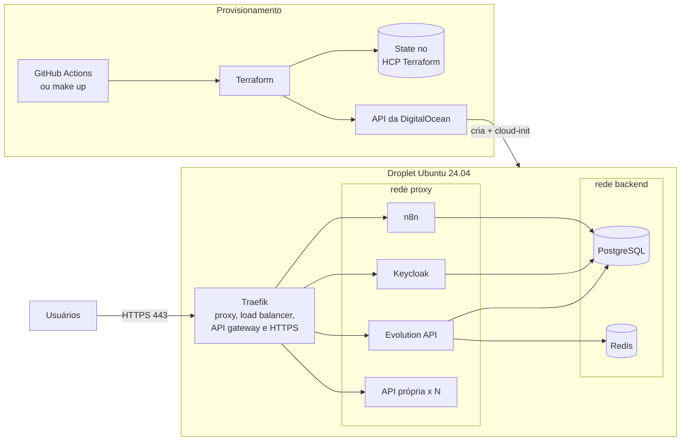

# infra-pdi

Infraestrutura recriável do zero com um clique: **Terraform + Docker Compose + Traefik**
na DigitalOcean. Projeto prático do meu PDI (Plano de Desenvolvimento Individual)
em DevOps.

**Do zero ao ar em ~X minutos**: um `make up` (ou um botão no GitHub Actions) cria o
servidor, aplica o hardening, instala o Docker e sobe toda a stack com HTTPS.
Um `make down` apaga tudo.

## Arquitetura



- **Só o Traefik tem portas públicas** (80 e 443). Os apps ficam numa rede interna.
- **Redes separadas:** o Traefik, exposto à internet, não alcança o banco.
- **HTTPS automático** com Let's Encrypt.
- **DNS** com DuckDNS, atualizado a cada recriação.

## Stack

| Serviço | Para que serve | Endereço |
| --- | --- | --- |
| Traefik | Proxy reverso, load balancer, API gateway e HTTPS | `traefik.DOMINIO` (com senha) |
| n8n | Automação de fluxos | `n8n.DOMINIO` |
| Keycloak | Login centralizado (OAuth2 / OpenID Connect) | `auth.DOMINIO` |
| Evolution API | API de WhatsApp | `wpp.DOMINIO` |
| API própria | Python, com Dockerfile e variáveis de ambiente | `gw.DOMINIO/api` |
| PostgreSQL | Banco de dados (um database por app) | só interno |
| Redis | Cache | só interno |

## Estrutura

```text
├── Makefile                  # make up / down / recreate / ssh / swarm
├── .github/workflows/        # botão up/down/recreate no GitHub Actions
├── scripts/
│   ├── env.sh                # carrega tokens e variáveis no terminal
│   └── wait-ready.sh         # espera a stack responder e mede o tempo
├── stack/
│   ├── compose.yaml          # stack para um servidor (Docker Compose)
│   ├── stack.yaml            # stack para cluster (Docker Swarm)
│   ├── .env.example
│   ├── postgres/init.sql
│   └── api/                  # Dockerfile + app.py
└── terraform/
    ├── main.tf               # Droplet, firewall, VPC, workers, senhas
    ├── variables.tf / outputs.tf / versions.tf
    ├── cloud-init.yaml.tftpl         # primeiro boot do servidor
    └── cloud-init-worker.yaml.tftpl  # primeiro boot dos workers
```

## Pré-requisitos

- Conta na DigitalOcean com token de API (leitura e escrita)
- Subdomínio no DuckDNS (ou domínio próprio)
- Conta no HCP Terraform (state remoto), workspace com Execution Mode **Local**
- Terraform 1.6+, Docker, `make` e chave SSH (no Windows, via WSL2)

## Como rodar

### Localmente (só a stack)

```bash
cd stack
cp .env.example .env   # preencha com valores reais
docker compose up -d
```

### Na nuvem, pelo terminal

```bash
source scripts/env.sh   # pede os tokens sem gravá-los no histórico
make up                 # cria tudo e espera a stack responder
make ssh                # entra no servidor
make down               # destrói tudo
```

### Na nuvem, pelo botão

Aba **Actions** → **infra** → **Run workflow** → `up`, `down` ou `recreate`.

## Segredos

Nenhum segredo vai para o Git:

| Segredo | Onde fica |
| --- | --- |
| Senhas de banco, Redis, n8n, Keycloak e Evolution | Geradas pelo Terraform (`random_password`), guardadas no state |
| Tokens da DigitalOcean, DuckDNS e HCP Terraform | Variáveis de ambiente locais e GitHub Secrets |
| Hash da senha do painel do Traefik | `stack/.env` (fora do Git) e GitHub Secrets |

## Números

| Medida | Resultado |
| --- | --- |
| `make recreate` (3 rodadas) | X min, Y min, Z min |
| Stack respondendo após o boot | ~X segundos |
| Gargalo | O primeiro boot (pacotes, Docker, imagens), não o Terraform |

## Escalonamento

| | Vertical | Horizontal (Docker Swarm) |
| --- | --- | --- |
| Como | Trocar o `size` do Droplet | Mais workers + réplicas |
| Tempo fora do ar | ~1min35s | Nenhum (`drain` redistribui as réplicas) |
| Custo | Dobrou (US$ 0,036 → 0,071/h) | Soma um worker menor |
| Limite | O maior Droplet disponível | Praticamente sem limite |
| Esforço | Uma variável | VPC, registry, Swarm e arquivo de stack |

## O que aprendi

O passo a passo, com os erros e as soluções de cada dia, está em [NOTAS.md](NOTAS.md).
Os pontos principais:

- **Infraestrutura como código:** o servidor existe porque o código diz que existe.
- **Corrigir na origem e recriar** é melhor que remendar o servidor à mão.
- **Funcionar na minha máquina não garante funcionar no CI**: o runner começa do zero.
- **A nuvem tem limites reais**: planos indisponíveis numa região, limite de
  certificados no Let's Encrypt.
- **Segurança em camadas:** firewall da nuvem, UFW, SSH só com chave, redes
  separadas, segredos fora do Git.

## Próximos passos

- Backups automáticos do PostgreSQL
- Monitoramento (Uptime Kuma ou Grafana)
- Encurtar o primeiro boot (imagem com Docker pronto)
- Kubernetes